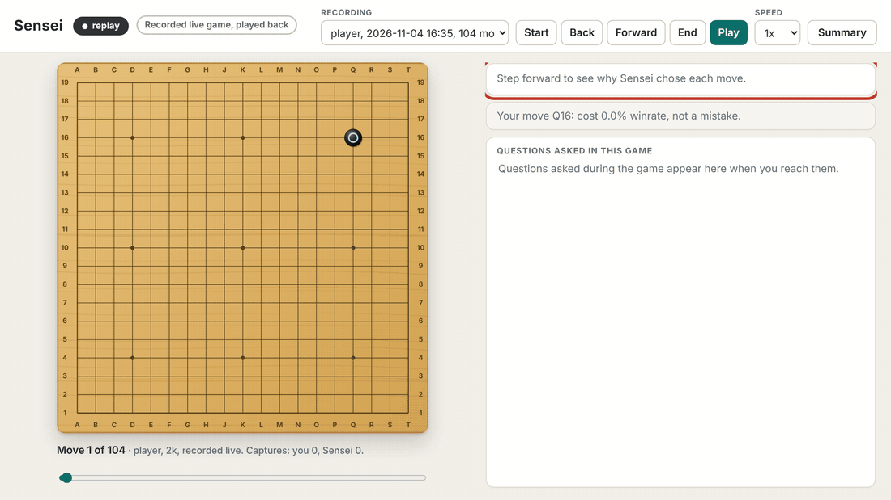
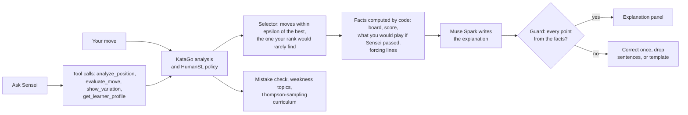

<!-- Generated by scripts/render_readme.py from README.tmpl.md; edit the template, not this file. Results: C1=C1_20261031-000756.json, C2=C2_20261031-134717.json, C2base=relevance_baselines.json, C3=C3_20261031-114828.json. -->
<div align="center">

# Sensei

**A Go coach that teaches by playing.**<br>
KataGo finds the moves, Muse Spark explains them, and you learn the ones that matter at your level.

[](LICENSE)
[](pyproject.toml)
[](https://github.com/lightvector/KataGo)
[-5d665f.svg)](#meta-models-and-api-features-used)
[](#evaluation)



[Quick start](#quick-start) · [What it does](#what-it-does) · [How it works](#how-it-works) ·
[Evaluation](#evaluation) · [Limitations](#limitations)

</div>

Strong Go engines tell you the best move; they cannot tell you which move you are ready to learn, or why it
matters. Sensei plays a full game against you and, on every move, picks the strong move a player of your rank would
rarely find, explains it in plain language from engine facts only, and answers your questions by calling engine
tools. Every explanation is checked against the engine's own output before it reaches the screen.

## Quick start

Watch a recorded game in replay mode. It needs neither a GPU, KataGo nor an API key. From a clone of this
repository (Windows PowerShell):

```powershell
py -3.12 -m venv .venv
.\.venv\Scripts\python.exe -m pip install -e ".[web]"
.\.venv\Scripts\python.exe -m sensei.app --replay results/demo_game.json
```

Linux or macOS: `python3.12 -m venv .venv`, then the same commands with `.venv/bin/python`. Open
http://127.0.0.1:8000/ and step through the game with the arrow keys. To play live against Sensei, see
[Setup](#setup).

## What it does

1. Pick an approximate rank (20k to 5d) and play a 19x19 game against Sensei.
2. After each of Sensei's moves, a side panel shows the move, a short explanation grounded on engine numbers,
   the position type (only move, tactical or strategic) and the strength the move cost against the engine's best.
3. After each of your moves, Sensei checks it with the engine. A mistake in your current weakness topic gets an
   immediate explanation; other mistakes are logged for the summary.
4. Ask Sensei anything about the position ("why did you play Q5?", "why not D4?", "what if I cut here?"). The
   model answers by calling engine tools, and every variation it mentions is drawn on the board.
5. At the end: the result, your estimated rank with its uncertainty, your two weakest topics with an example
   each, and the topic the next game will train.

## How it works



- **Move selection.** KataGo's reliable candidates within epsilon of the best winrate form the admissible set.
  Sensei plays the admissible move with the largest pointwise contribution to KL(engine policy || learner
  policy): a move the engine likes and a player of your rank would rarely find. The bound epsilon caps the
  strength Sensei gives away; the model never chooses moves.
- **Learner model.** KataGo's HumanSL network predicts human moves at a given rank. Your rank is the maximum
  likelihood profile over your own moves, and the learner policy is the HumanSL policy at that rank.
- **Weakness topics and curriculum.** Every move becomes a bag of situation tokens (phase, region, position type,
  captures, contact, tenuki). Topics are fitted with LDA on windows of mistakes from public games; a discounted
  Thompson-sampling curriculum picks the topic where you err most, and that topic decides which mistakes get an
  immediate explanation.
- **Grounded explanations.** The model receives only facts computed by code: the engine's numbers, where each
  point is in Go terms ("right side, 2nd line"), and what a move does to the stones around it (captures, ataris,
  liberties, connections, and shapes such as a one-space jump or a knight's move). The reason for a move comes from
  the engine too: one extra search finds what the learner would play there if Sensei passed and what that move would
  do to Sensei's stones, how many points Sensei's move is worth against passing, and, from the engine's own line,
  whether it is a forcing move that Sensei can play first and still take the top move. The prompt names Sensei's color
  and the learner's, so "I" and "you" always point at the right stones, and it bans engine internals such as policy
  priors and visit counts. A guard rejects any reply that names a board coordinate absent from those facts or the tool
  results: it asks once for a correction, then drops offending sentences, then falls back to a template.

## Meta models and API features used

- Muse Spark (`muse-spark-1.3`) through the Meta Model API's OpenAI-compatible chat completions.
- Tool calling with four tools: `analyze_position`, `evaluate_move`, `show_variation`, `get_learner_profile`
  (`tool_choice` auto, with a final round without tools when the tool budget is spent).
- `reasoning_effort` per call; every call is logged with its token counts and estimated cost.

## Evaluation

Three claims were pre-registered before any run (`SCOPE.md`, `configs/prereg.yaml`); every number below is
rendered from a result file in `results/` written by `eval/run.py` from a clean git commit.

<!-- results -->
| Claim | Result | Pre-registered criterion | Verdict |
|---|---|---|---|
| C1 Strength cost of teaching | strength cost -12 Elo, positive meaning Sensei is weaker (95% CI -45 to 21), score rate 51.7% over 400 games against the raw engine, epsilon 0.01 | upper end of the CI below 150 Elo | pass |
| C2 Lesson relevance on human games | uplift 1.00 percentage points (95% CI 0.03 to 1.95) over 2,000 positions | CI above zero | pass |
| C3 Curriculum (simulation) | mistake-rate AUC of round robin minus Thompson 0.193 (95% CI 0.187 to 0.200) over 50 simulated learners; Thompson closes 83% of the gap to an oracle (95% CI 80% to 85%) | Thompson below round robin, CI excluding zero | pass |

C1 ran 96,646 engine searches in 1.2 hours on one NVIDIA GeForce RTX 3090 with 8 games in flight.
Deviations from the pre-registration, each listed with its reason in the result file: C1 0,
C2 0, C3 0.

C2 in context (descriptive, added after C2 ran, not pre-registered; `eval/relevance_baselines.py`): from one band
to the next, players play the engine's best move 1.26 times as often and a random admissible move
1.27 times as often. Sensei's lesson is played 1.23 times as often, rising
at a rate not distinguishable from a random admissible move (ratio 0.96, 95% CI
0.75 to 1.25). The lesson Sensei picks for
15k-10k players is played by 3.4% of them and by
8.0% of 1d-3d players; over the same range the engine's best
move goes from 11.8% to 23.6%.
<!-- /results -->

C1 asks how much playing strength Sensei gives up by teaching instead of winning. C2 asks whether the moves
Sensei would teach a band of players are moves that the next stronger band actually plays; its pre-registered
test compares that rate with zero. Stronger players play good moves more often in general, so the context
paragraph compares the lesson with the engine's best move and with a random admissible move on the same
positions, which shows how much of the uplift is specific to Sensei's choice. C3 is a closed-loop
simulation with assumed learning dynamics: it shows that the curriculum finds and targets weaknesses under those
dynamics, not that people learn faster.

## Setup

Requires Python 3.11 or 3.12, KataGo with a main network and the HumanSL network, and a Meta Model API key.
Windows (PowerShell):

```powershell
py -3.12 -m venv .venv
.\.venv\Scripts\python.exe -m pip install -e ".[dev,web]"
Copy-Item .env.example .env   # then fill in MODEL_API_KEY and the KATAGO_* paths
.\.venv\Scripts\python.exe scripts/meta_smoke_test.py
.\.venv\Scripts\python.exe -m pytest -q
```

Linux or macOS: `python3.12 -m venv .venv`, then the same commands with `.venv/bin/python`.

Run the coach at http://127.0.0.1:8000/:

```powershell
.\.venv\Scripts\python.exe -m sensei.app            # live: KataGo and the Meta Model API from .env
.\.venv\Scripts\python.exe -m sensei.app --fake     # offline demo: fake engine, canned explanations, no API calls
.\.venv\Scripts\python.exe -m sensei.app --replay   # play back recorded games from sessions/ and results/
```

Every game is recorded to `sessions/`; replay mode needs neither a GPU nor an API key, so it is the mode to host.

## Repository layout

```
src/sensei/   the coach: selector, learner model, explainer and guard, topics, curriculum, session, web app
eval/         the evaluation harness for the three pre-registered claims (never calls the Meta Model API)
scripts/      data fetching, splits, explainer set, topic fitting, README rendering and number checks
configs/      prereg.yaml (frozen before any run) and default.yaml (runtime settings)
results/      every result file, the graded explanation sets, and the recorded demo game
tests/        offline tests (engine and network tests are marked and skipped by default)
```

## Limitations

- C3 is a simulation, not a study with people; C2 measures relevance on recorded games, not learning gains.
- C2's uplift is small and, compared on the same positions with the engine's best move and a random admissible
  move, not specific to Sensei's choice: stronger players play every good move more often (the context paragraph
  under the evaluation table).
- The rank estimate is close for dan players and off by several ranks for kyu players in a held-out check
  (`results/learner_check.json`, descriptive), so Sensei can start too strong for a weaker player until it has
  seen enough of their moves.
- Rank labels come from the game server's scale, which need not match the scale of the HumanSL training data.
- Explanations can only be as good as the engine numbers they are grounded on, and the guard checks
  coordinates, not reasoning.
- Explanation quality was graded by one player, the author (2d to 4d), on the ten explainer positions, not blind;
  the explainer passed the bar set before grading only after several revisions of the facts it is given
  (`results/explanations_*_grades.md` holds every grade and note). The graded version is v4.1; the submitted v4.2
  changes only Ask Sensei (questions about moves already played) and was checked on one recorded game, not graded.
- In a decided game every move keeps the win, so the winrate bound lets Sensei play a move several points worse
  than the engine's top move; the explanation then says the top move is better for points.
- An explanation and an Ask Sensei answer come from separate engine searches and can name different likely replies.
- In live play an explanation arrives several seconds after Sensei's move, because the model reasons before it
  writes; replay mode has no wait.
- The tactical and strategic labels come from policy-entropy thresholds that were never calibrated.
- 19x19 only, Chinese rules and komi 7.5 in play.

## Credits and related work

- KataGo (David J. Wu) and its HumanSL network (July 2024), which supplies rank-conditioned human move
  predictions. KataGo's Extra Networks page suggests using that network for player rank estimation and as a
  mistake filter in teaching tools; Sensei uses rank estimation as a component, not as a contribution.
- Strength estimation from rank-specific policies has its own literature (for example "Policies of Multiple Skill
  Levels for Better Strength Estimation in Games", 2025), and human-policy-guided move selection has related work
  in chess and Go (for example Maia, and MATILDA, 2026). Sensei's distinct element is selecting moves for their
  teaching value under an explicit strength bound, with explanations grounded only on engine output.

## License and citation

Sensei's code is released under the [MIT License](LICENSE). KataGo, its networks and the game records are not
included; they keep their own licenses and sources (`data/SOURCES.md`). To cite Sensei, use
[`CITATION.cff`](CITATION.cff). The narration of the demo video is a synthetic voice cloned from the author's own
voice.
